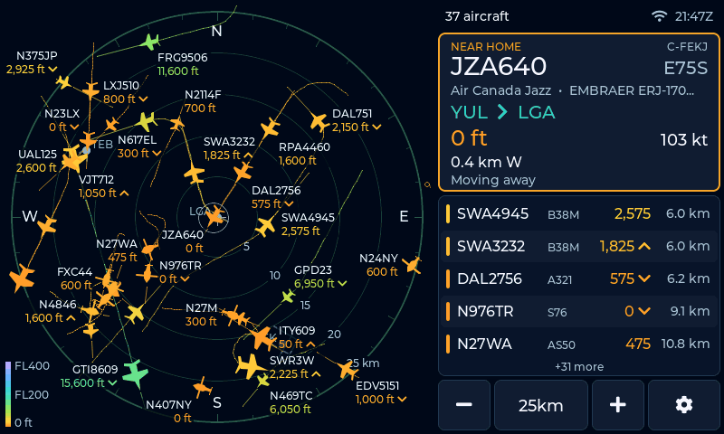

# Plane Radar for the Elecrow CrowPanel 7-inch



*New York traffic around LaGuardia at 25 km. The frames are 25 seconds apart, so aircraft jump here; on the panel they glide.*

A port of [ESP32-Plane-Radar](https://github.com/MatixYo/ESP32-Plane-Radar) by MatixYo to the **[Elecrow CrowPanel Basic 7-inch](https://www.elecrow.com/esp32-display-7-inch-hmi-display-rgb-tft-lcd-touch-screen-support-lvgl.html)** touch display (ESP32-S3, 800×480). It shows live **ADS-B** traffic from [adsb.fi](https://opendata.adsb.fi/) around your location on a radar you drive by touch.

The original firmware, for an ESP32-C3 Super Mini with a 1.28″ round display, is still in this repository as the `supermini` build target; see [The original round-display target](#the-original-round-display-target).

## What it shows

The screen is a radar on the left and a sidebar on the right.

- **Radar.** Aircraft coloured by altitude and drawn by type and size, each with a callsign and altitude tag, a trail behind it and a line to where it will be in a minute. Ranges of 5, 10, 25 and 50 km with every ring labelled, and airports with their runways.
- **Card.** The nearest aircraft in the air, or the one you tap: callsign, type, operator, where it is flying from and to, altitude, speed, distance, and when and how near it will pass.
- **List and status.** The next five aircraft, and a strip with the aircraft count, Wi-Fi and the local time that turns into a warning when the data goes stale.
- **Settings.** Refresh rate (2 to 10 s), altitude and ground filters, three themes, brightness, km or miles, a clock in local time, UTC or a zone you pick (12- or 24-hour), a home-airport search, and **Find me**, which sets the radar's location from a phone's GPS.

The full list is in [docs/CROWPANEL.md](docs/CROWPANEL.md).

## Hardware

- **[Elecrow CrowPanel Basic 7-inch HMI](https://www.elecrow.com/esp32-display-7-inch-hmi-display-rgb-tft-lcd-touch-screen-support-lvgl.html)**, model DIS08070H: ESP32-S3-WROOM-1-N4R8, 800×480 RGB TFT, GT911 capacitive touch, 8 MB PSRAM. This is not the newer CrowPanel Advance.
- A USB-C data cable and a 5 V / 2 A supply.
- Optional: a microSD card for CSV logging, and the printable feet in [stand/](stand/README.md).

The build assumes board revision V3. For V1 or V2, see "Hardware revision and touch" in [docs/CROWPANEL.md](docs/CROWPANEL.md).

## Build and flash

With [PlatformIO](https://platformio.org/):

```bash
pio run -e crowpanel7 -t upload
pio device monitor -b 115200
```

PlatformIO fetches the libraries: LVGL 8.4, LovyanGFX, WiFiManager and ArduinoJson.

`crowpanel7-debug` is the same firmware plus serial commands for taking screenshots and recordings of the screen; the scripts that use them are in `scripts/`.

## First start

1. The panel opens a Wi-Fi access point called **`PlaneRadar-Setup`**. Join it, open `http://192.168.4.1`, and enter your Wi-Fi details. A latitude and longitude can be typed in here too.
2. Once the panel is on your network, set its location on the panel itself: **Settings (the gear) → Change → Find me**, then scan the code with a phone on the same Wi-Fi. The phone warns that the connection is not private, because the panel signs its own certificate; [docs/CROWPANEL.md](docs/CROWPANEL.md) explains why that cannot be avoided. Or search for a home airport instead.
3. Tap an aircraft to pin it to the card, and tap the card or empty radar to let go.

## Things to know

- **Routes are best-effort.** They come from ADSBDB by callsign and are shown only when the aircraft is somewhere along the route. Many flights have none.
- **The settings page has no password.** As in the original firmware, the panel serves a settings page on your network at `http://plane-radar.local`, and it includes a firmware-upload page. That suits a home network. Build with `-DPLANE_RADAR_LAN_PORTAL=0` to leave it out.
- **It is not a flight instrument.** The alerts and highlights are for hobby use. This is not for navigation, collision avoidance or flight safety.

## How this fork relates to upstream

The port is a second PlatformIO target, `crowpanel7`, on top of upstream's `main`. Nearly all of it is new files under `src/crowpanel/` and `include/crowpanel/`, including the panel's own aircraft feed client and airport table. Upstream's code for the round display is as upstream has it, apart from small additions to `radar_location`, `radar_range`, `wifi_setup` and `platformio.ini` that the round-display build does not use.

So the round-display target here should behave as upstream's does, but it has not been run on hardware from this fork. For a round display, use [upstream](https://github.com/MatixYo/ESP32-Plane-Radar).

## The original round-display target

What follows is the original project's README, as it applies to the `supermini` target in this fork.

**3D printed case (STL + assembly):** [MakerWorld](https://makerworld.com/en/models/2872376-esp32-plane-radar-live-ads-b-on-a-round-display#profileId-3207083) · **Firmware:** [Releases](https://github.com/MatixYo/ESP32-Plane-Radar/releases)

Firmware for an **ESP32-C3 Super Mini** and a **1.28″ round GC9A01** display (240×240). Shows a circular **ADS-B radar** around your configured location, with **WiFiManager** for first-time setup.

### What it does

1. **Wi‑Fi setup** (if needed) — captive portal on AP **`PlaneRadar-Setup`**
2. **Radar** — live aircraft from [adsb.fi](https://opendata.adsb.fi/) on a sonar-style grid

After Wi‑Fi is saved, the device reconnects automatically; the radar runs in the main loop with periodic ADS-B updates (~5 s).

### Controls (BOOT, GPIO 9, active LOW)

| Action | Effect |
|--------|--------|
| **Short tap** | Cycle range preset (5 → 10 → 15 → 25 km); saved to flash |
| **Hold 3 s** | Clear Wi‑Fi, location, and units; reboot into setup portal |

During setup you can also hold BOOT at power-on to force a credential reset (same as the long press).

### Wi‑Fi setup portal

**First-time setup** (no saved Wi‑Fi):

1. Connect to **`PlaneRadar-Setup`**
2. Open **`http://plane-radar.local`** (preferred) or **`http://192.168.4.1`** — both are shown on the yellow setup screen; captive portal may open automatically
3. Set home Wi‑Fi, then save

**Reconfigure anytime** (after the device is on your network):

1. Open **`http://plane-radar.local`** or **`http://<device-ip>`** (e.g. from your router or serial log at boot)
2. Change Wi‑Fi, location, units, or runway overlay; save

The same portal runs on the setup AP and on the device’s LAN IP while connected to Wi‑Fi. mDNS hostname is `plane-radar` → **plane-radar.local** (`kPortalHostname` in `config.h`). Some clients resolve `.local` slowly; use the IP if needed.

**Custom fields** (stored in NVS):

| Field | Purpose |
|-------|---------|
| **Latitude / Longitude** | Radar center and ADS-B query position (defaults in `config.h` until set) |
| **Display distances in miles** | Ring scale label in **mi** instead of **km** (e.g. `6mi` vs `10km`) |
| **Show airport runways** | Major-airport runway overlay on the radar (off to hide) |

After a reset, the device reboots and shows the setup screen immediately (no “Connecting” loop on stale credentials).

### Radar display

#### Grid

- Dark blue background, subdued green rings and crosshairs
- White **N / S / E / W** at the bezel; range label on the **east** spoke (ring 3 = ¾ of outer radius)
- White center dot

Layout and colors: `include/ui/radar_theme.h`.

#### Range presets

| Ring 3 label | Outer radius (aircraft scale) |
|------------|-------------------------------|
| 5 km / 3 mi | ~6.7 km |
| 10 km / 6 mi | ~13.3 km (default) |
| 15 km / 9 mi | ~20 km |
| 25 km / 16 mi | ~33.3 km |

Preset and miles/km choice persist across reboot (`planeradar` NVS namespace).

#### Runways

- Major airports from OurAirports (`large_airport`); all open runway strips in range (helipads excluded)
- Teal runway lines with one ICAO label per airport (e.g. `KJFK`); toggle in the Wi‑Fi setup portal
- Update the embedded list: `python3 scripts/build_large_airports.py`

#### Aircraft

- **Inside the outer ring** — red heading triangle, magenta speed vector (clipped at the ring), callsign / type / altitude tags
- **Outside the ring** (still within ADS-B fetch) — small **red dot on the screen rim** at the correct bearing (direction cue; not distance-accurate past the ring)
- **Tags** — placed toward the **center**: west (left) → tag on the **right** of the symbol; east (right) → tag on the **left**

As range decreases (or aircraft approach), targets move inward; beyond-ring dots become full symbols when they cross the outer ring.

#### ADS-B

- Source: `https://opendata.adsb.fi/api/v3/`
- Fetch radius: `ui::radar::fetchRadiusKm()` — scales with the active preset to roughly the screen edge (so rim dots have data)
- Poll interval: `kAdsbFetchIntervalMs` (5 s) in `config.h`
- Ground aircraft hidden by default (`kAdsbShowGroundAircraft`)

### Configuration

Edit **`include/config.h`** for hardware and behavior:

| Area | Keys / notes |
|------|----------------|
| Portal | `kPortalApName`, `kPortalIp`, `kPortalHostname` / `kPortalHostUrl` (mDNS; needs `-DWM_MDNS` in `platformio.ini`) |
| Wi‑Fi timing | connect attempts, reconnect grace, portal timeout (`0` = no timeout) |
| BOOT | `kBootPin`, `kBootResetHoldMs`, `kBootTapMinMs` |
| Display SPI | pins, `kDisplayInvert`, `kDisplayRgbOrder`, `kDisplaySpiWriteHz` |
| Default location | `kDefaultRadarLat`, `kDefaultRadarLon` (until portal overrides) |
| ADS-B | `kAdsbFetchIntervalMs`, `kAdsbShowGroundAircraft` |

Range presets: `include/ui/radar_range.h` (`kRangePresets`).

### Project layout

```
include/
  config.h
  hardware/
    lgfx_config.hpp
    display.h
    display_font.h
  data/
    large_airports.h
  ui/
    radar_theme.h
    radar_range.h
    radar_display.h
    runway_overlay.h
    status_screens.h
  services/
    wifi_setup.h
    radar_location.h
    adsb_client.h
data/
  ui_font.vlw              — embedded smooth UI font (Noto Sans Bold)
scripts/
  build_large_airports.py
src/
  main.cpp
  data/
    large_airports_data.cpp
  hardware/
  ui/
  services/
```

### Wiring (GC9A01 ↔ ESP32-C3 Super Mini)

| Display | ESP32-C3 |
|---------|----------|
| VCC | 3V3 |
| GND | GND |
| RST | GPIO **0** |
| CS | GPIO **1** |
| DC | GPIO **10** |
| SDA (MOSI) | GPIO **3** |
| SCL (SCLK) | GPIO **4** |
| BOOT (user) | GPIO **9** |

### Build

```bash
pio run -t upload
pio device monitor
```

- PlatformIO env: **`supermini`**
- Serial: **115200** baud
- USB CDC on boot enabled in `platformio.ini` for the Super Mini

#### Web-flashable release image

Single `.bin` for [esptool-js](https://espressif.github.io/esptool-js/) and similar tools (ESP32-C3, 4 MB, flash at **0x0**):

```bash
chmod +x scripts/merge-firmware.sh   # once
./scripts/merge-firmware.sh
```

Writes `release/plane-radar-merged.bin`. Skip rebuild if firmware is already built:

```bash
./scripts/merge-firmware.sh --no-build
```

Or via PlatformIO only (output: `.pio/build/supermini/firmware-merged.bin`):

```bash
pio run -e supermini
pio run -t merge -e supermini
```

Put the board in download mode (hold **BOOT**, tap **RESET**), then flash with Chrome/Edge over USB.

#### CI and releases (GitHub Actions)

| Workflow | When | Output |
|----------|------|--------|
| [Build](.github/workflows/build.yml) | Push / PR to `main` | Artifact `plane-radar-supermini` (merged + split `.bin` files, ~90 days) |
| [Release](.github/workflows/release.yml) | Git tag `v*` (e.g. `v1.0.0`) | GitHub Release asset `plane-radar-v1.0.0.bin` + `.sha256` |

To ship a version users can download:

```bash
git tag v1.0.0
git push origin v1.0.0
```

The release workflow builds firmware in CI and attaches the merged image to the release. Download from **Releases** on GitHub, then flash at **0x0** (ESP32-C3, 4 MB).

### Dependencies

- [LovyanGFX](https://github.com/lovyan03/LovyanGFX)
- [WiFiManager](https://github.com/tzapu/WiFiManager)
- [ArduinoJson](https://github.com/bblanchon/ArduinoJson)

## Licence

MIT, as upstream. See [LICENSE](LICENSE).
